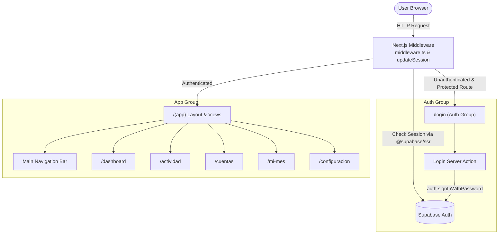

# Requirements

### Overview & Goals
Initialize the core foundation for the Personal Finance ERP application (Phase 1) according to `SPEC.md` and `.ai/rules.md`. This phase establishes strict type safety, robust session management via `@supabase/ssr`, route protection via Next.js Middleware, user authentication (Login/Logout), and the minimalist navigation layout.

### Scope
- **In Scope:**
  - Installation and configuration of `@supabase/ssr`, `@supabase/supabase-js`, `lucide-react`, `clsx`, and `tailwind-merge`.
  - Supabase client utilities for Browser, Server Components / Server Actions, and Middleware session updates.
  - Next.js root `middleware.ts` for route protection and session token refresh.
  - Complete TypeScript database definitions in `types/database.types.ts` covering all 16 tables and enums from `supabase/schema.sql`.
  - Authentication flow: Login page (`/login`), Login/Logout Server Actions, Auth callback route.
  - Authenticated layout group `app/(app)` with responsive desktop header and mobile navigation bar covering the 4 primary sections (*Inicio*, *Actividad*, *Mis Cuentas*, *Mi Mes*) and secondary *Configuración*.
  - Placeholder route pages for `/dashboard`, `/actividad`, `/cuentas`, `/mi-mes`, and `/configuracion`.
  - Root route (`/`) redirection to `/dashboard`.

- **Out of Scope (Reserved for subsequent phases):**
  - Phase 2: Category management, exchange rates, and Onboarding wizard.
  - Phase 3: Bank accounts, credit cards, loans, and investment portfolio details.
  - Phase 4: Transaction forms, installment processing, and shared expense splitting.
  - Phase 5: Budget limits and monthly fixed expenses checklist.
  - Phase 6: Financial projection engine and dashboard charts.

### User Stories
- **US-1 (User Authentication):** As a user, I want to log in using my email and password so that my financial data remains private and secure under Row Level Security.
- **US-2 (Session Security & Route Guarding):** As a user, I want unauthenticated attempts to view financial pages to be redirected to `/login`, and my session to be refreshed seamlessly in the background.
- **US-3 (Seamless Navigation):** As a user, I want a clean, minimalist navigation bar on both desktop and mobile to switch between *Inicio*, *Actividad*, *Mis Cuentas*, *Mi Mes*, and *Configuración*.
- **US-4 (Sign Out):** As a user, I want to easily sign out of my account from any view.

### Functional Requirements
- **FR-1:** Authentication must use Supabase Auth with email and password.
- **FR-2:** Unauthenticated users accessing `/dashboard`, `/actividad`, `/cuentas`, `/mi-mes`, `/configuracion` must be redirected to `/login`.
- **FR-3:** Authenticated users accessing `/login` must be redirected to `/dashboard`.
- **FR-4:** Navigation must provide intuitive active state indicators for the current route.
- **FR-5:** All UI text, button labels, and validation error messages must be in **Spanish (Peru)**, while code identifiers, comments, and file names remain in **English**.

### Non-Functional Requirements
- **NFR-1 (Type Safety):** Zero usage of `any`; all database operations and components must be typed using `types/database.types.ts`.
- **NFR-2 (Mobile First & Performance):** Responsive layout optimized for mobile screens (bottom navigation bar) and desktop screens (top navigation bar).
- **NFR-3 (SSR Compatibility):** Authentication state and cookie handling must adhere to `@supabase/ssr` Next.js App Router standards.

# Technical Design

### Current Implementation
The repository is an initial Next.js 16 (App Router) project with React 19, TypeScript, and Tailwind CSS v4. The Supabase schema is defined in `supabase/schema.sql` with 16 tables and strict RLS policies. No Supabase client libraries, types, middleware, or auth views are implemented yet.

### Key Decisions
1. **Supabase SSR Pattern:** Implement `@supabase/ssr` with separate client creators for browser (`client.ts`), server components/actions (`server.ts`), and middleware (`middleware.ts`), strictly using Next.js `cookies()` and header propagation.
2. **Route Group Separation:**
   - `app/(auth)/login` for public authentication views.
   - `app/(app)` route group for authenticated views sharing the common shell and navigation layout (`layout.tsx`).
3. **Database Types Strategy:** Handcraft/generate `types/database.types.ts` mirroring `supabase/schema.sql` exactly, exporting `Database` and helper generic types (`Tables`, `Enums`, `InsertDto`, `UpdateDto`).
4. **Navigation UX:** Mobile-first layout featuring a sticky top bar with user profile/logout and a sticky bottom navigation bar for mobile devices, expanding to a clean horizontal desktop navigation on larger viewports.

### Architecture Diagram


### Data Models / Contracts
```typescript
// types/database.types.ts
export type Json = string | number | boolean | null | { [key: string]: Json | undefined } | Json[];

export type CurrencyCode = 'PEN' | 'USD';
export type CategoryType = 'INCOME' | 'EXPENSE';
export type AccountType = 'BANK_ACCOUNT' | 'CASH_BOX';
export type ExemptionRuleType = 'NONE' | 'MIN_MONTHLY_SPEND' | 'MIN_ANNUAL_SPEND';
export type TransactionType =
  | 'INCOME'
  | 'EXPENSE'
  | 'TRANSFER'
  | 'CC_PAYMENT'
  | 'REFUND'
  | 'SHARED_REPAYMENT'
  | 'LOAN_PAYMENT';
export type SplitStatus = 'PENDING' | 'PARTIAL' | 'PAID';

export interface Database {
  public: {
    Tables: {
      user_settings: {
        Row: {
          user_id: string;
          base_currency: CurrencyCode;
          include_cash_in_balance: boolean;
          onboarding_completed: boolean;
          created_at: string;
          updated_at: string;
        };
        Insert: {
          user_id: string;
          base_currency?: CurrencyCode;
          include_cash_in_balance?: boolean;
          onboarding_completed?: boolean;
          created_at?: string;
          updated_at?: string;
        };
        Update: Partial<Database['public']['Tables']['user_settings']['Insert']>;
      };
      // ... all 16 tables: exchange_rates, categories, accounts, credit_cards, credit_card_statements,
      // loans, investments, investment_monthly_logs, transactions, installment_plans,
      // shared_expense_splits, budgets, fixed_expenses_template, monthly_fixed_checklist, projected_events
    };
    Enums: {
      currency_code: CurrencyCode;
      category_type: CategoryType;
      account_type: AccountType;
      exemption_rule_type: ExemptionRuleType;
      transaction_type: TransactionType;
      split_status: SplitStatus;
    };
  };
}

export type Tables<T extends keyof Database['public']['Tables']> = Database['public']['Tables'][T]['Row'];
export type Enums<T extends keyof Database['public']['Enums']> = Database['public']['Enums'][T];
```

### File Structure
```
├── app
│   ├── (app)
│   │   ├── layout.tsx              # Authenticated layout with Navbar & User Menu
│   │   ├── dashboard/page.tsx      # Inicio placeholder
│   │   ├── actividad/page.tsx      # Actividad placeholder
│   │   ├── cuentas/page.tsx        # Mis Cuentas placeholder
│   │   ├── mi-mes/page.tsx         # Mi Mes placeholder
│   │   └── configuracion/page.tsx  # Configuración placeholder
│   ├── (auth)
│   │   └── login
│   │       ├── actions.ts          # Server actions: login, logout
│   │       └── page.tsx             # Login form UI in Spanish
│   ├── auth
│   │   └── callback
│   │       └── route.ts            # OAuth / auth code callback handler
│   ├── layout.tsx                  # Root layout
│   └── page.tsx                    # Root redirect to /dashboard
├── components
│   └── navigation
│       ├── main-nav.tsx            # Navigation links with active states
│       ├── user-menu.tsx           # User badge and logout trigger
│       └── mobile-nav.tsx          # Mobile bottom navigation bar
├── lib
│   ├── supabase
│   │   ├── client.ts               # Browser Supabase client
│   │   ├── server.ts               # Server Component / Server Action client
│   │   └── middleware.ts           # Middleware session handler
│   └── utils.ts                    # cn() styling helper
├── middleware.ts                   # Next.js route protection middleware
└── types
    └── database.types.ts           # Generated TypeScript definitions for 16 tables
```

# Testing

### Validation Approach
Verification will be performed by checking TypeScript compilation, ESLint rules, and route protection behaviors.

### Key Scenarios
1. **TypeScript Type Verification:**
   - Execute TypeScript check (`npx tsc --noEmit`) to verify that `types/database.types.ts` is strictly typed, free of syntax errors, and fully compatible with `@supabase/ssr`.
2. **Middleware & Route Guarding:**
   - Validate that unauthenticated requests to `/dashboard`, `/actividad`, `/cuentas`, `/mi-mes`, `/configuracion` are intercepted by `middleware.ts` and redirected to `/login`.
   - Validate that unauthenticated requests to `/login` display the login form.
   - Validate that root `/` redirects appropriately.
3. **Login & Logout Flow:**
   - Verify that `login` Server Action correctly invokes `supabase.auth.signInWithPassword` and handles invalid credentials with descriptive Spanish error messages.
   - Verify that `logout` Server Action invokes `supabase.auth.signOut` and redirects to `/login`.
4. **Navigation & Responsive Layout:**
   - Verify all 5 navigation links (*Inicio*, *Actividad*, *Mis Cuentas*, *Mi Mes*, *Configuración*) render properly, indicate active state when selected, and navigate to their respective route shells.
   - Verify layout responsiveness across desktop and mobile screen sizes.

### Edge Cases
- **Missing or Invalid Supabase Environment Variables:** Ensure helper functions fail gracefully with descriptive error guidance if `NEXT_PUBLIC_SUPABASE_URL` or `NEXT_PUBLIC_SUPABASE_ANON_KEY` are unset.
- **Session Token Refresh:** Verify `updateSession` preserves response cookies so tokens refresh seamlessly without unexpected logout.

# Delivery Steps

### ✓ Step 1: Setup Dependencies, Supabase SSR Clients & Auth Middleware
Supabase SSR packages and UI utilities are installed, and client/server helper functions and authentication middleware are operational.

- Install required packages: `@supabase/ssr`, `@supabase/supabase-js`, `lucide-react`, `clsx`, `tailwind-merge`.
- Create `lib/supabase/client.ts` exporting `createClient()` using `createBrowserClient` with `NEXT_PUBLIC_SUPABASE_URL` and `NEXT_PUBLIC_SUPABASE_ANON_KEY`.
- Create `lib/supabase/server.ts` exporting `createClient()` using `createServerClient` and Next.js `cookies()` store for Server Components and Server Actions.
- Create `lib/supabase/middleware.ts` with `updateSession(request)` to refresh expired auth tokens and handle redirection logic.
- Create root `middleware.ts` with Next.js matcher configuration to protect application routes (`/dashboard`, `/actividad`, `/cuentas`, `/mi-mes`, `/configuracion`) and redirect unauthenticated requests to `/login`.

### ✓ Step 2: Database TypeScript Schema Generation
The full database TypeScript definitions matching all 16 tables, enums, and views from schema.sql are in place.

- Create `types/database.types.ts` defining all custom PostgreSQL enums: `currency_code`, `category_type`, `account_type`, `exemption_rule_type`, `transaction_type`, `split_status`.
- Implement TypeScript interfaces for all 16 tables: `user_settings`, `exchange_rates`, `categories`, `accounts`, `credit_cards`, `credit_card_statements`, `loans`, `investments`, `investment_monthly_logs`, `transactions`, `installment_plans`, `shared_expense_splits`, `budgets`, `fixed_expenses_template`, `monthly_fixed_checklist`, `projected_events`.
- Export helper utility types (`Tables<T>`, `Enums<T>`, `InsertDto<T>`, `UpdateDto<T>`) to guarantee strict typing across all server actions and client queries without `any`.

### ✓ Step 3: Authentication Actions & Login View
The login page and authentication Server Actions allow users to sign in, view validation errors, and log out securely.

- Create `app/(auth)/login/actions.ts` containing Server Actions `login(formData)` and `logout()` using `lib/supabase/server.ts` with error handling in Spanish.
- Create `app/(auth)/login/page.tsx` with a minimalist, responsive UI (email, password, submit button with loading state, and error message banners).
- Create `app/auth/callback/route.ts` to handle auth code exchanges if email confirmation or OAuth redirects are triggered.
- Ensure authenticated users attempting to access `/login` are automatically redirected to `/dashboard`.

### ✓ Step 4: Main Application Layout & Navigation Shells
The main authenticated layout renders the minimalist navigation bar and placeholder shells for all primary application sections.

- Create `app/(app)/layout.tsx` enforcing server-side session validation and rendering the main navigation header and mobile bottom bar.
- Implement `components/navigation/main-nav.tsx` and `components/navigation/user-menu.tsx` with links to the 4 core sections (*Inicio* `/dashboard`, *Actividad* `/actividad`, *Mis Cuentas* `/cuentas`, *Mi Mes* `/mi-mes`) plus secondary access to *Configuración* (`/configuracion`) and logout action.
- Create placeholder shell pages for `/dashboard`, `/actividad`, `/cuentas`, `/mi-mes`, and `/configuracion` showing consistent headers and clean visual structure.
- Update root `app/page.tsx` to redirect to `/dashboard`.