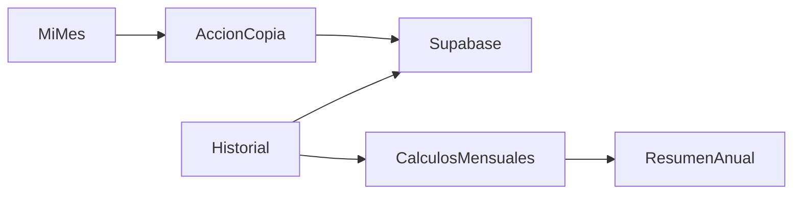

# Requisitos

### Presupuestos
- En «Mi Mes», copiar explícitamente los presupuestos del mes calendario anterior a las categorías que aún no tengan presupuesto este mes, sin sobrescribir los existentes. Informar el resultado o la ausencia de presupuestos anteriores.

### Historial
- Añadir una sección independiente para consultar meses anteriores y el acumulado desde enero hasta el mes actual, inclusive, en la zona horaria de Lima.
- Mostrar ingresos, gastos, balance y presupuesto frente a consumo por categoría. Permitir consultar meses de años anteriores y mostrar estados vacíos.
- Los datos son cálculos actuales sobre registros existentes, no cierres históricos inmutables.

# Diseño técnico

### Integración
- `app/(app)/mi-mes/actions.ts`: añadir una acción autenticada que derive en el servidor el mes actual y el anterior, consulte solo datos del usuario e inserte los presupuestos faltantes usando la restricción única con `ignoreDuplicates`, para evitar sobrescrituras incluso ante solicitudes simultáneas. Revalidar las vistas afectadas.
- `app/(app)/mi-mes/page.tsx` y `components/month/month-panel.tsx`: exponer la acción y sus estados de carga, éxito y error, siguiendo `useActionState`.
- La nueva página protegida consulta datos de Supabase con el patrón `connection()`, `createClient()` y `auth.getUser()` existente. Reutiliza `calculateMonthTotals` de `lib/dashboard/calculations.ts` y `calculateBudgetUsage` de `lib/month/calculations.ts`; agrupa resultados mensuales para el año. Incluir gastos sin presupuesto y categorías inactivas con registros históricos.
- Corregir el filtro de reembolsos por categoría en `calculateBudgetUsage` y normalizar la categoría del movimiento original también en el dashboard, para evitar deducir el mismo reembolso de todas las categorías.
- Mantener la conversión existente con la última tasa disponible y explicitar que los importes históricos en PEN pueden cambiar al actualizarla; si falta tasa necesaria, mostrar un error claro, sin inventar una tasa.
- Los pagos fijos históricos usan el periodo del checklist y los datos disponibles de plantilla y transacción; señalar que los cambios en plantillas y transacciones pueden alterar el historial. No se crea una tabla de snapshots.

### Archivos
- Modificar `app/(app)/mi-mes/actions.ts`, `app/(app)/mi-mes/page.tsx`, `components/month/month-panel.tsx`, `lib/month/calculations.ts` y `app/(app)/dashboard/page.tsx`.
- Crear `app/(app)/historial/page.tsx`, `components/history/history-panel.tsx` y `lib/history/calculations.ts` para consultas, presentación y agregación respectivamente.
- Añadir la entrada a `components/navigation/nav-items.ts`; ajustar navegación móvil si es necesario para cinco elementos.
- Añadir pruebas en `test/` siguiendo el patrón `node:test`.

### Flujo

# Validación

- Verificar copia parcial, repetida y concurrente, ausencia de datos y transición diciembre-enero; confirmar aislamiento por usuario y conservación de importes existentes.
- Comprobar meses vacíos, años anteriores, acumulado hasta el mes actual y categorías sin presupuesto o inactivas.
- Probar cuotas, pagos fijos, reembolsos por categoría, gastos compartidos y conversiones con y sin tasa; comparar el mes actual con los cálculos existentes.
- Ejecutar `npm test`, `npm run lint` y `npm run build`; verificar navegación accesible en escritorio y móvil.

# Delivery Steps

### ✓ Step 1: Reutilizar presupuestos anteriores
Mi Mes permite copiar los presupuestos faltantes del mes anterior sin modificar los existentes.
- Implementar la acción autenticada y la resolución segura de periodos en `mi-mes/actions.ts`.
- Conectar el control y los mensajes en `month-panel.tsx`.
- Añadir pruebas de copia, conflictos y cambio de año.

### ✓ Step 2: Construir cálculos históricos consistentes
Los datos mensuales y anuales se calculan con las reglas financieras existentes.
- Preparar agregación mensual y anual en `lib/history/calculations.ts`.
- Corregir la atribución de reembolsos por categoría y alinear el dashboard.
- Añadir pruebas de cuotas, pagos fijos, categorías y conversión monetaria.

### ! Step 3: Presentar la sección de historial
Una sección accesible permite consultar meses anteriores y el acumulado anual.
- Crear la página protegida y el panel con selección de mes y resumen anual.
- Integrar la sección en la navegación compartida y adaptar la presentación móvil.
- Verificar estados vacíos, aislamiento, lint y compilación.