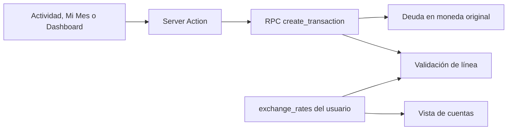

# Requisitos

### Resultado
- Registrar gastos con tarjeta sin solicitar un tipo de cambio manual, también desde gastos fijos y eventos proyectados.
- Conservar importe y moneda originales en el movimiento y en la deuda PEN/USD; utilizar el último tipo USD→PEN configurado solo para calcular y validar la línea disponible.
- Mantener el tipo real obligatorio en transferencias y pagos entre monedas distintas.

### Casos especiales
- Si se necesita convertir deuda para validar la línea y no existe tipo referencial, rechazar la compra con un mensaje que indique configurarlo; no inventar un cambio 1:1. Si no hace falta convertir, permitirla.
- Mantener el rechazo por exceso de línea, la atomicidad y la posibilidad de revertir movimientos, incluso si cambió el tipo referencial.
- Actualizar `SPEC.md` para reemplazar la regla contradictoria de exigir un tipo aplicado a compras con tarjeta.

# Diseño técnico

### Estado actual
`components/activity/new-operation-dialog.tsx` y `components/dashboard/dashboard-panel.tsx` solicitan un cambio manual para gastos con tarjeta. Las acciones de Actividad, Mi Mes y Dashboard llaman a `create_transaction`; esta no asigna el cambio recibido a los gastos, mientras `adjust_card_debt` intenta convertir ambas deudas usando el cambio de la transacción. `app/(app)/cuentas/page.tsx` y `components/accounts/accounts-panel.tsx` calculan la línea con el último tipo, pero utilizan `1` si falta.

### Cambios
- Añadir una migración Supabase que mantenga `create_transaction` y sus argumentos compatibles, pero haga que el control de línea consulte `exchange_rates` por `auth.uid()`, ordenado por `rate_date` descendente, en el servidor y dentro de la operación atómica. No confiar en el tipo enviado por el cliente para consumos de tarjeta.
- Conservar `transactions.amount` y `currency`, la deuda en su moneda y los planes de cuotas/splits originales; para compras con tarjeta dejar `applied_exchange_rate` y `converted_amount` sin cambio real aplicado. Convertir solo la deuda opuesta a la moneda de la línea, con el redondeo existente, y comprobar el total contra el límite bajo el bloqueo de la tarjeta.
- Separar la comprobación de límite de los ajustes que reducen deuda y de las reversiones; estos no deben requerir un tipo referencial ni quedar bloqueados por un cambio posterior del límite. Preservar el tipo real y `converted_amount` de pagos cruzados y transferencias, y sus reversiones.
- Ajustar ambos formularios de compra para eliminar el campo manual; si se muestra una referencia, identificarla como estimación de línea, no como cargo a una cuenta. Mantener el campo real para transferencias y pagos cruzados. Las acciones de Actividad y Dashboard dejarán de enviar el tipo para gastos con tarjeta; Mi Mes seguirá utilizando la misma RPC.
- En Mis Cuentas, usar un tipo nullable: mostrar deuda original y valores calculables sin conversión; donde se necesite un tipo ausente, mostrar un aviso en lugar de cifras 1:1. Al guardar o sincronizar el tipo en `app/(app)/configuracion/actions.ts`, revalidar Cuentas, Actividad y Dashboard.

### Archivos
- Modificar: `components/activity/new-operation-dialog.tsx`, `components/dashboard/dashboard-panel.tsx`, `app/(app)/actividad/actions.ts`, `app/(app)/dashboard/actions.ts`, `app/(app)/cuentas/page.tsx`, `components/accounts/accounts-panel.tsx`, `app/(app)/configuracion/actions.ts` y `SPEC.md`.
- Añadir: migración en `supabase/migrations/` y pruebas de integración SQL en `supabase/tests/`; ampliar `test/activity-calculations.test.mjs` si se extraen cálculos puros.

### Flujo

# Validación

### Pruebas
- Añadir pruebas SQL contra Supabase local con usuarios y tipos aislados: compras PEN→USD y USD→PEN, deuda previa en ambas monedas, misma moneda, límite exacto y superado, cuotas y gastos compartidos. Verificar importes originales, ausencia de conversión real, saldos y rollback al fallar.
- Comprobar que se usa el registro más reciente del usuario, aunque la fecha de compra sea anterior; sin tipo, probar tanto conversiones necesarias como casos sin conversión.
- Probar pagos y transferencias cruzadas con tipo real distinto del referencial; reembolsos, eliminación de compra y reversión de pago/reembolso tras cambiar o quitar el tipo.
- Verificar los tres puntos de entrada y que Mis Cuentas no muestre 1:1 cuando falta el tipo; comprobar actualización tras guardarlo o sincronizarlo. Ejecutar `npm test`, `npm run lint`, compilación y pruebas SQL locales cuando esté disponible Supabase.

# Delivery Steps

### ✓ Step 1: Corregir la validación atómica de la línea
Las compras con tarjeta se validan con el último tipo referencial del usuario sin convertir el movimiento original.

- Añadir una migración para la lógica de `adjust_card_debt` y sus llamadas desde `apply_transaction_effects`, conservando el contrato de `create_transaction`.
- Consultar el tipo solo cuando sea necesario para validar una compra y mantener separados los cambios reales de pagos y transferencias.
- Preservar reversiones y atomicidad; añadir pruebas SQL de monedas, límites, ausencia de tipo y rollback.

### ✓ Step 2: Adaptar los formularios de registro
Actividad y proyecciones registran gastos con tarjeta sin pedir un tipo manual.

- Actualizar `new-operation-dialog.tsx`, `dashboard-panel.tsx` y sus acciones para no solicitar ni enviar un cambio real en estos gastos.
- Mantener el campo para operaciones que sí convierten dinero y comprobar el flujo de Mi Mes, cuotas y gastos compartidos.
- Verificar casos de integración de reembolsos, pagos y eliminaciones con el cambio referencial actualizado.

### ✓ Step 3: Alinear la visualización y la especificación
Mis Cuentas muestra una línea coherente con el tipo configurado y la especificación refleja la regla nueva.

- Eliminar el valor ficticio 1:1 de los cálculos afectados en `cuentas/page.tsx` y `accounts-panel.tsx`; mostrar un aviso cuando falte el tipo necesario.
- Revalidar las vistas afectadas tras guardar o sincronizar el tipo en `configuracion/actions.ts`.
- Actualizar `SPEC.md` y ejecutar pruebas, lint y compilación disponibles.