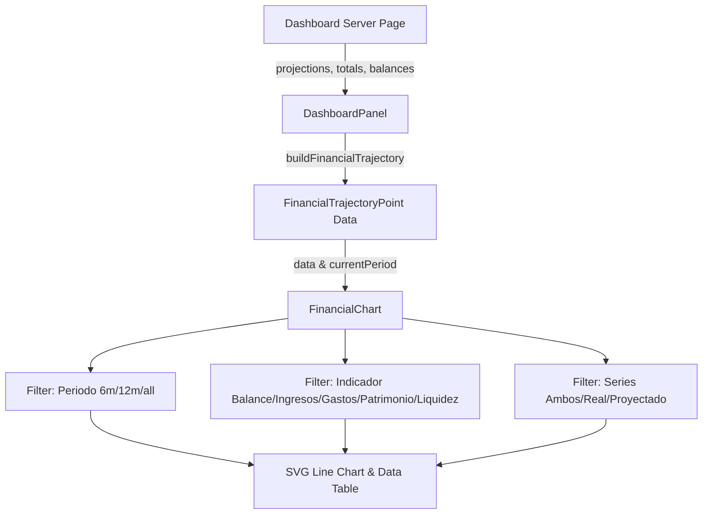

# Requirements

### Overview & Goals
Combine the two existing projection charts (`WealthChart` for wealth/liquidity and `ProjectionChart` for cash flow) into a single unified financial chart. The new view eliminates redundant visual components and gives the user full control via 3 adjustable parameters: Periodo (time range), Indicador (financial metric), and Series (real vs. projected comparison), presented under a concise and representative title.

### Scope
#### In Scope
- Unify data modeling in `lib/dashboard/calculations.ts` to merge flow indicators (income, expenses, net balance) and stock balances (net worth, liquidity) along a single chronological timeline.
- Build a unified `FinancialChart` component with 3 parameter selectors:
  1. **Periodo**: 6 meses, 12 meses, Todo el periodo.
  2. **Indicador**: Balance neto, Ingresos, Gastos, Patrimonio, Liquidez.
  3. **Series**: Real y proyectado, Solo real, Solo proyectado.
- Update `components/dashboard/dashboard-panel.tsx` to render this single chart instead of two separate cards.
- Support responsive SVG plotting, adaptive domain scaling, zero-baseline, current period indicator, point tooltips, and expandable tabular breakdown.
- Unit test coverage for calculation and timeline integration in `test/`.

#### Out of Scope
- Altering underlying projection simulation math (budgets, installments, loan payments, projected events).
- Modifying PDF report generation or budget configuration forms.
- Reconstructing nonexistent historical wealth/liquidity snapshots prior to current period.

### User Stories
- As a user, I want a single unified chart on the projections page so that I can see all my financial insights without navigating between separate, duplicate graphs.
- As a user, I want to filter by period, metric, and series so that I can easily compare real vs. projected values for any flow or balance indicator.

### Functional Requirements
- **Single Chart Header**: Clean card titled "Evolución financiera: real vs. proyectado" with subtitle explaining the view.
- **Filter 1 - Periodo**: Controls visible timeline window (`6`, `12`, `all`), centered around the current period or spanning available bounds.
- **Filter 2 - Indicador**: Dropdown supporting:
  - Flujo mensual: `Balance neto`, `Ingresos`, `Gastos`.
  - Saldos acumulados: `Patrimonio`, `Liquidez`.
- **Filter 3 - Series**: Dropdown supporting `Real y proyectado`, `Solo real`, and `Solo proyectado`.
- **Visualization Features**:
  - Green solid line for Real and violet dashed line for Proyectado.
  - Interactive data dots with currency tooltips (`S/ X.XX`).
  - Vertical dashed indicator identifying the active/current period.
  - Zero reference line when domain spans negative and positive values.
  - Context note clarifying partial current-month actuals and current exchange rate conversions.
  - Expandable `<details>` section containing a monthly summary table reflecting active selections.

# Technical Design

### Current Implementation
- `components/dashboard/projection-chart.tsx`: Displays real vs. projected flow metrics (balance, income, expenses) with range and series selectors.
- `components/dashboard/wealth-chart.tsx`: Displays real vs. projected wealth and liquidity with horizon and metric selectors.
- `components/dashboard/dashboard-panel.tsx`: Renders both charts one after another in `view === 'projections'`.
- `lib/dashboard/calculations.ts`: Separately produces `ProjectionComparisonMonth[]` and `WealthProjectionPoint[]`.

### Key Decisions
- **Unified Timeline Data Model**: Combine flow metrics and accumulated balances into a single `FinancialTrajectoryPoint` model via `buildFinancialTrajectory`. Periods encompass past actual months, current period, and future projected months.
- **Single Component Architecture**: Consolidate `ProjectionChart` and `WealthChart` into `FinancialChart` (`components/dashboard/financial-chart.tsx`), eliminating duplicated SVG path generation, axis scaling, and legend styling.
- **3-Parameter Configuration Interface**: Standardize controls into three aligned dropdowns: Periodo (`range`), Indicador (`metric`), and Series (`visibleSeries`).

### Architecture Diagram


### Data Models / Contracts
```ts
export type FinancialMetric = 'net' | 'income' | 'expenses' | 'netWorth' | 'liquidity';
export type VisibleSeries = 'both' | 'actual' | 'projected';

export interface FinancialTrajectoryPoint {
  period: string;
  actualIncome: number | null;
  actualExpenses: number | null;
  actualNet: number | null;
  actualNetWorth: number | null;
  actualLiquidity: number | null;
  projectedIncome: number | null;
  projectedExpenses: number | null;
  projectedNet: number | null;
  projectedNetWorth: number | null;
  projectedLiquidity: number | null;
}

export interface FinancialChartProps {
  data: FinancialTrajectoryPoint[];
  currentPeriod: string;
}
```

### Components
- `FinancialChart` (`components/dashboard/financial-chart.tsx`): Unified client component managing the 3 filters, SVG rendering, dynamic legend, and breakdown table.
- `DashboardPanel` (`components/dashboard/dashboard-panel.tsx`): Invokes `buildFinancialTrajectory` and renders a single `<FinancialChart />`.

### File Structure
- `lib/dashboard/calculations.ts` (modified: adds `FinancialTrajectoryPoint` and `buildFinancialTrajectory`)
- `components/dashboard/financial-chart.tsx` (new: unified chart component)
- `components/dashboard/dashboard-panel.tsx` (modified: replaces separate charts with `FinancialChart`)
- `components/dashboard/wealth-chart.tsx` (removed or replaced by unified component)
- `components/dashboard/projection-chart.tsx` (removed or replaced by unified component)
- `test/dashboard-financial-chart.test.mjs` (new or updated: unit tests for trajectory calculation)

### Risks
- Historical wealth/liquidity points are not tracked prior to current month: Handled gracefully by returning `null` for past balance actuals and displaying informative text.
- Mixed scale between flow metrics (e.g. S/ 500) and wealth totals (e.g. S/ 50,000): Mitigated because the user selects one metric at a time, allowing the Y-axis to scale optimally to that metric's domain.

# Testing

### Validation Approach
- Validate data calculation logic with targeted Node unit tests.
- Verify component types, Next.js build, and lint checks.

### Key Scenarios
- **Flow Metric Comparison**: Selecting `Balance neto`, `Ingresos`, or `Gastos` displays past actuals, current month MTD vs projected, and future projections.
- **Balance Metric Comparison**: Selecting `Patrimonio` or `Liquidez` displays current actual balance, estimated current month close, and future accumulated monthly closes.
- **Series Visibility**: Toggling between `Real y proyectado`, `Solo real`, and `Solo proyectado` updates the visible SVG lines, legend, and table columns.
- **Period Range**: Slicing by 6 months, 12 months, or all periods preserves proper centering around the current month without clipping data.

### Edge Cases
- Periods with zero or negative net balances/net worth (proper zero line positioning).
- No future projections configured (fallback gracefully to available actual points).
- Crossing calendar year boundaries (e.g. 2025-12 to 2026-01).

# Delivery Steps

### ✓ Step 1: Consolidate financial trajectory calculation logic and data models
Unified trajectory data model is implemented in `lib/dashboard/calculations.ts` and validated with unit tests.

- Define `FinancialTrajectoryPoint` combining actual and projected values for income, expenses, net balance, net worth, and liquidity across all relevant periods.
- Implement `buildFinancialTrajectory` that integrates recent actual monthly totals, current actual wealth and liquidity, and future monthly projections into a single chronological timeline.
- Maintain compatibility with existing helpers while ensuring robust handling of null values for historical wealth and future actuals.
- Add comprehensive unit tests in `test/dashboard-financial-chart.test.mjs` validating flow calculation, balance accumulation, year boundary transitions, and empty projection scenarios.

### ✓ Step 2: Implement unified FinancialChart component with 3-parameter controls
A single, versatile financial chart component is created with period, metric, and series controls.

- Implement `FinancialChart` in `components/dashboard/financial-chart.tsx` featuring a concise, representative header ("Evolución financiera: real vs. proyectado").
- Add three adjustable dropdown controls: Periodo (`6 meses`, `12 meses`, `Todo el periodo`), Indicador (`Balance neto`, `Ingresos`, `Gastos`, `Patrimonio`, `Liquidez`), and Series (`Real y proyectado`, `Solo real`, `Solo proyectado`).
- Render a responsive SVG line chart featuring dynamic Y-axis scaling, zero-line baseline, current-period vertical marker, dynamic series legend, and hover tooltips formatted in PEN.
- Add an accessible expandable monthly detail table displaying the exact numbers corresponding to the active filter configuration.

### ✓ Step 3: Integrate unified chart into DashboardPanel and clean up redundant views
Projections view in `DashboardPanel` displays a single representative chart, removing duplicate graphics.

- Update `components/dashboard/dashboard-panel.tsx` (and `app/(app)/dashboard/page.tsx` if needed) to construct and supply the unified financial trajectory dataset.
- Replace separate instances of `WealthChart` and `ProjectionChart` with the unified `FinancialChart` in the projections tab.
- Remove redundant duplicate chart files and imports to keep the codebase clean.
- Run complete test suite and project build (`npm test`, `npm run lint`, `npm run build`) to verify regression-free execution.